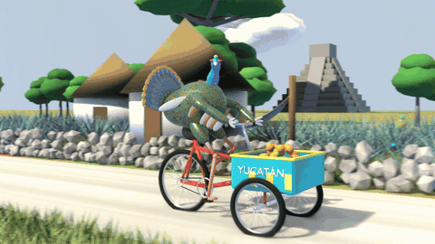
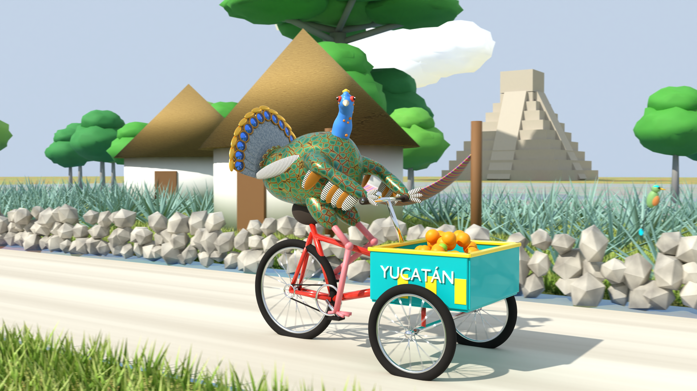
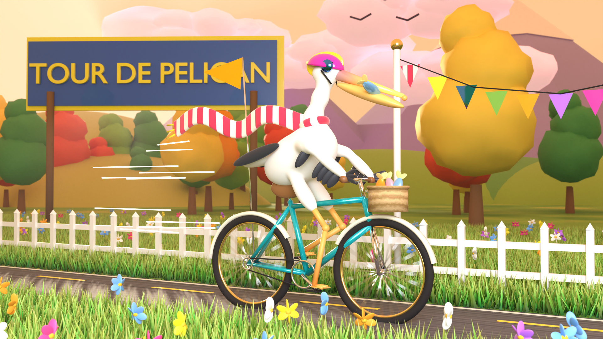

# Ocellated turkey on a triciclo 🦃🛺

**An ocellated turkey (*pavo ocelado*) riding a Yucatecan cargo *triciclo* down a sascab road —
a tropicalized, 3D Blender take on Simon Willison's "pelican riding a bicycle" LLM test.**



Full-quality video (1280×720, 30 fps, 14 s loop): see the
[latest release](https://github.com/hizmarck/ocellated-turkey-triciclo/releases/latest).



## Where the idea comes from

On 25 October 2024 Simon Willison published
[**Pelicans on a bicycle**](https://simonwillison.net/2024/Oct/25/pelicans-on-a-bicycle/): he asked 16
LLMs to *"Generate an SVG of a pelican riding a bicycle"* — because he likes pelicans and was pretty
sure there weren't any pelican-on-a-bicycle SVGs in the training data yet. It has since become a
popular informal test of how well models reason about shapes they can't see.

This project is a **Yucatán version of that idea**. It started as the pelican (kept in
[`extras/pelican`](extras/pelican)), then got tropicalized:

| The original idea | Tropicalized for Yucatán |
|---|---|
|  |  |
| Pelican — long pouch bill, webbed feet | **Ocellated turkey** — endemic to the Yucatán Peninsula, blue warty head, eye-spotted tail |
| Bicycle | **Triciclo** — the cargo tricycle you see in every Yucatecan town |

> **Note:** Willison's test asks a *text-only* model to write SVG code blind. This repo is a 3D
> homage built and iterated in Blender with visual feedback — not a run of his benchmark.
> Want to try the real thing on your favorite model? Use:
>
> *"Generate an SVG of an ocellated turkey riding a Yucatecan triciclo."*

### Why this turkey?

It scores well on what makes the pelican a good test subject: anatomy that fights the vehicle
(stocky body, short legs, a tail fan), an instantly recognizable silhouette, no existing
"turkey on a bike" imagery to memorize, and an unmistakably local identity — the ocellated turkey
lives only on the Yucatán Peninsula. The more famous flamingo was already taken by other pelican
variants.

## What's Yucatecan in the scene

| Element | What it is |
|---|---|
| *Pavo ocelado* (*kuts* in Maya) | The ocellated turkey — the rider |
| *Triciclo* | Front cargo-box tricycle, here loaded with oranges from Oxkutzcab |
| *Sascab* road | The white crushed-limestone roads of rural Yucatán |
| *Albarrada* | Dry-stacked limestone walls lining roads and fields |
| *Henequén* | The agave behind the wall — the "green gold" of the old haciendas |
| *Casa maya* | Oval limewashed house under a steep *huano* palm-thatch roof |
| *Hamaca* | A striped hammock slung by the house |
| *Ceiba* | The sacred Maya tree, with its layered horizontal branches |
| *Toh* | The turquoise-browed motmot perched on the wall — Yucatán's emblematic bird |
| El Castillo | The Chichén Itzá pyramid on the horizon |

## Run it

Requires [Blender 5.1](https://www.blender.org/). Everything is built procedurally by one script.

```bash
BLENDER=/Applications/Blender.app/Contents/MacOS/Blender   # adjust for your OS

$BLENDER -b -P turkey_triciclo.py                          # Cycles still  -> turkey_triciclo.png
MODE=check FRAMES=1,120,300 $BLENDER -b -P turkey_triciclo.py  # quick EEVEE test frames
MODE=anim $BLENDER -b -P turkey_triciclo.py                # 420-frame loop -> frames_turkey/, MP4 + GIF
PREVIEW=1 ...                                              # half resolution, fewer samples/plants
```

`MODE=anim` encodes with [ffmpeg](https://ffmpeg.org/) if it's installed. Or just open
`turkey_triciclo.blend` and press <kbd>Space</kbd> (switch the viewport to *Material Preview* or
*Rendered* to see the colors).

## How it's made

- **Turkey body** — metaballs blended into one smooth shape, then baked to a mesh; scalloped
  iridescent plumage from a Voronoi *distance-to-edge* pattern with thin-film sheen.
- **Legs** — two-bone IK armature; feet ride level pedals driven by the crank.
- **Neck** — a three-bone chain with skinned weights, so the head can bob like a turkey and turn to
  look at the camera without detaching from the body.
- **Motion** — Follow Path lap with steering keyed through the U-turns; wheels spin at
  speed ÷ radius; everything loops seamlessly (whole number of pedal revolutions per lap).
- **Camera** — follows a time-smoothed copy of the path instead of the rider itself, so it never
  whips around in the turns.
- **Set** — instanced agaves, wall stones and trees; geometry-nodes grass swaying in a noise wind;
  bounded volumetric haze.

## Credits & license

- Idea: [Simon Willison — "Pelicans on a bicycle"](https://simonwillison.net/2024/Oct/25/pelicans-on-a-bicycle/).
- Code (`*.py`, `*.blend`): [MIT](LICENSE).
- Images and video (`media/`, `extras/pelican/*.png`, release assets):
  [CC BY 4.0](media/LICENSE.md).
