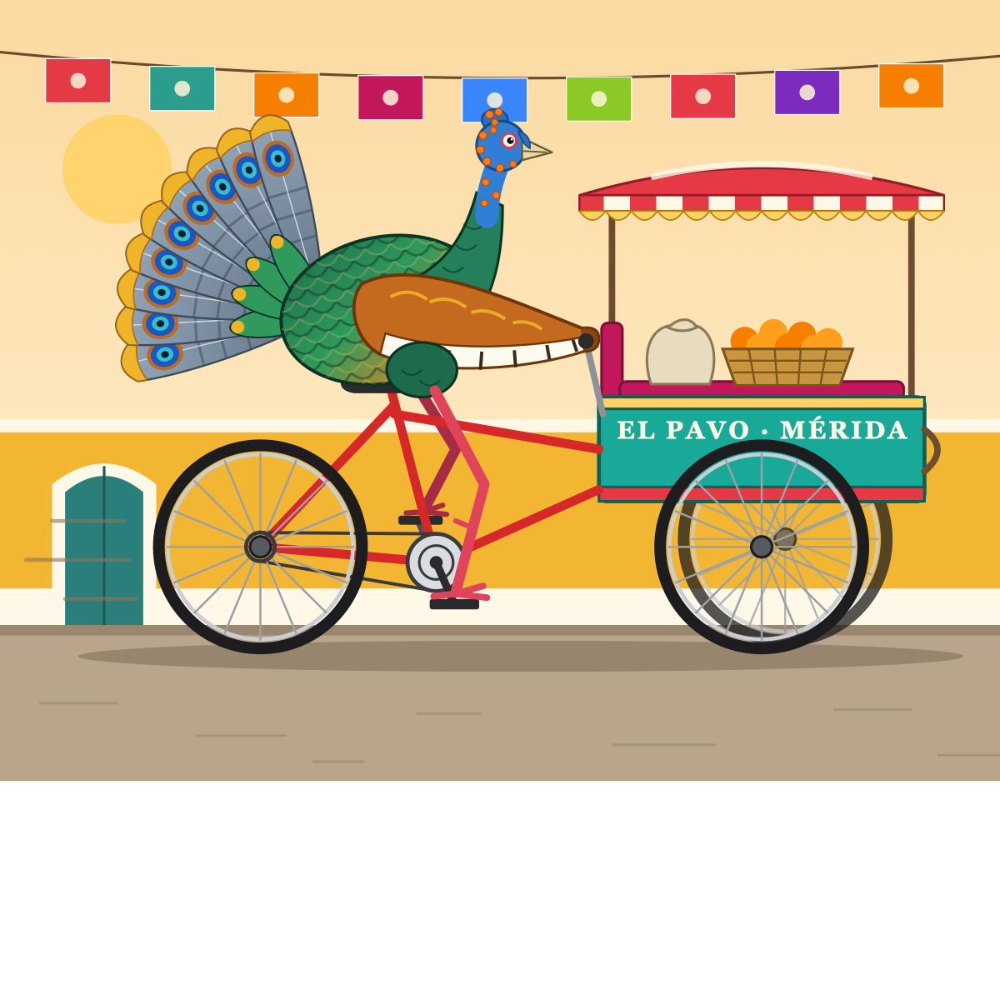
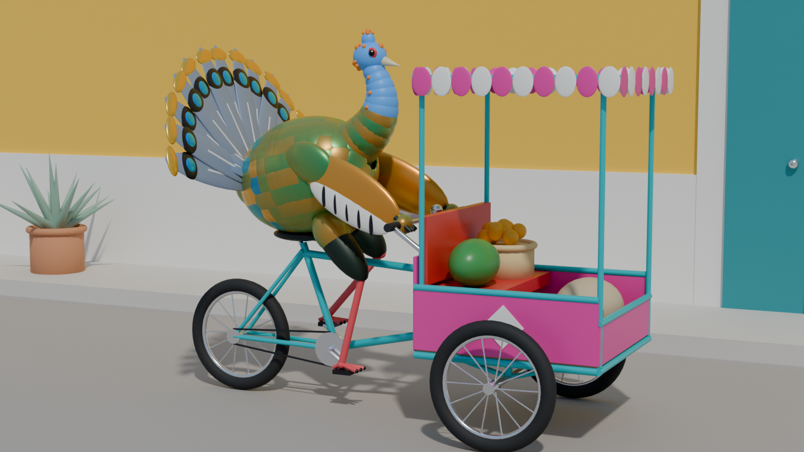
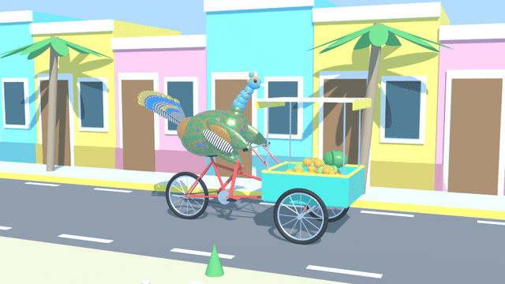

# Blind test: Fable 5.2

The same idea run as a real blind test, in the spirit of Simon Willison's
["Pelicans on a bicycle"](https://simonwillison.net/2024/Oct/25/pelicans-on-a-bicycle/):
the model wrote each file in one shot, without reading this repo, running code, or seeing a render.
Everything here is its unmodified output (Claude Fable 5.2, 18 Nov 2026).

| SVG | Blender still | Blender animation |
|---|---|---|
|  |  |  |

## Prompts

| File | Prompt |
|---|---|
| `turkey_triciclo.svg` | *"Generate an SVG of an ocellated turkey riding a Yucatecan triciclo."* |
| `turkey_3d.py` | *"Write a Blender Python script that builds and renders a 3D scene of an ocellated turkey riding a Yucatecan triciclo."* |
| `turkey_ride.py` | *"Write a Blender Python script that builds a 3D scene of an ocellated turkey riding a Yucatecan triciclo, and animate a seamless loop of it pedaling."* |

The Blender prompts came with a short run contract: Blender 5.1, `blender -b -P <script>`, save
output next to the script (a still PNG, or a `frames/` PNG sequence at 30 fps), keep render time
reasonable. The GIF was encoded from the frames with the same ffmpeg settings as the main project.

## Results

| | SVG | 3D still | 3D animation |
|---|---|---|---|
| Model time / cost | — | 6 min / $2.82 | 13 min / $3.35 |
| Ran first try | ✅ | ✅ (45 s, Cycles) | ✅ (39 s, EEVEE, 72 frames) |
| Two front wheels under a cargo box | ❌ bicycle + box | ✅ | ✅ |
| Blue warty head | ✅ | ✅ | ✅ |
| Turkey tail (not a peacock fan) | ❌ | ❌ | ❌ |
| Feet on the pedals | ❌ | ⚠️ partly | ✅ animated |
| Wings stay wings (not arms) | ❌ | ❌ | ❌ |
| Seamless loop | — | — | ✅ |

The same two mistakes show up in all three: a peacock-style tail fan and wings used as arms on
the handlebar.

## Run it

```bash
BLENDER=/Applications/Blender.app/Contents/MacOS/Blender
$BLENDER -b -P turkey_3d.py      # -> turkey_triciclo.png (Cycles still; git-ignored)
$BLENDER -b -P turkey_ride.py    # -> frames/ (72 PNGs, EEVEE)
```
