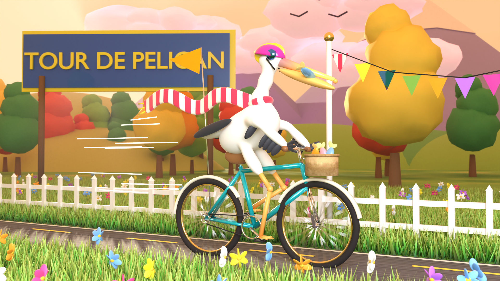

# The original: a pelican on a bicycle

Where this project started — a 3D Blender homage to Simon Willison's
["Pelicans on a bicycle"](https://simonwillison.net/2024/Oct/25/pelicans-on-a-bicycle/) test,
at golden hour, before it was tropicalized into the ocellated turkey.



```bash
/Applications/Blender.app/Contents/MacOS/Blender -b -P pelican_bicycle.py            # Cycles still
MODE=anim /Applications/Blender.app/Contents/MacOS/Blender -b -P pelican_bicycle.py  # 8 s loop
```
